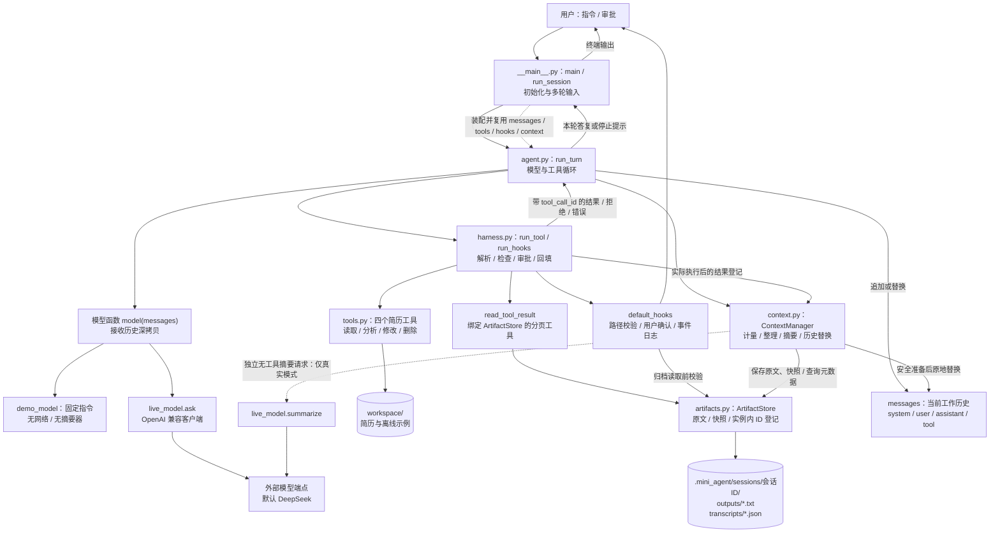
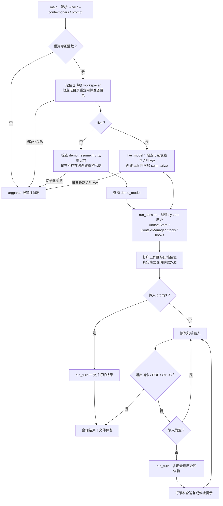
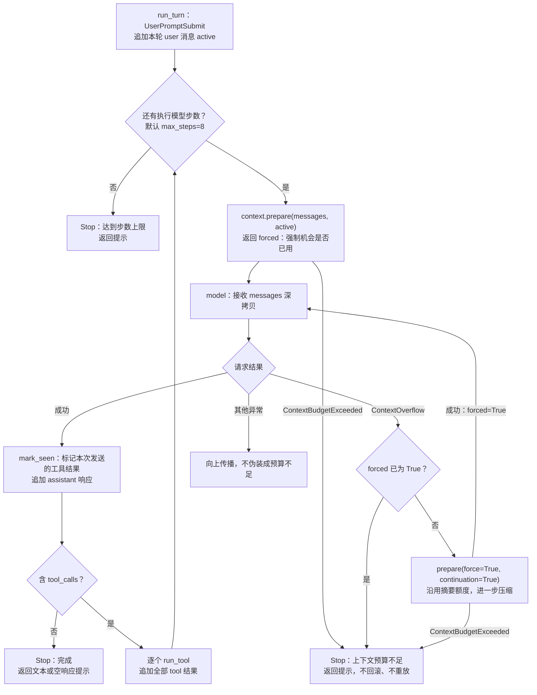
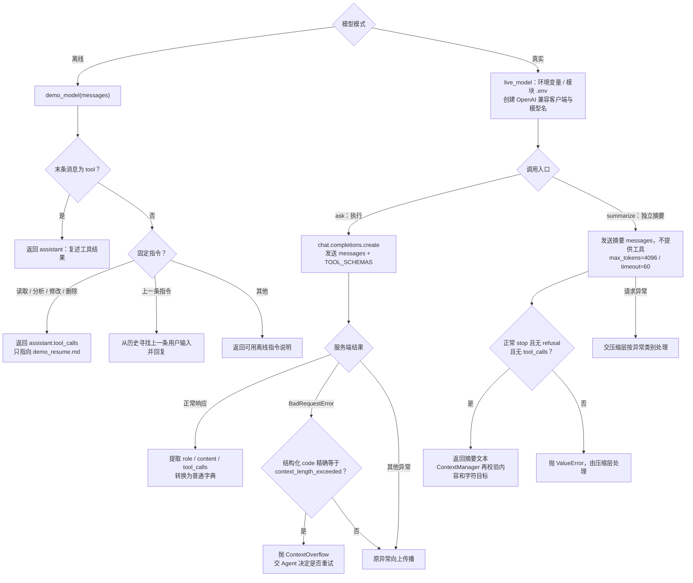
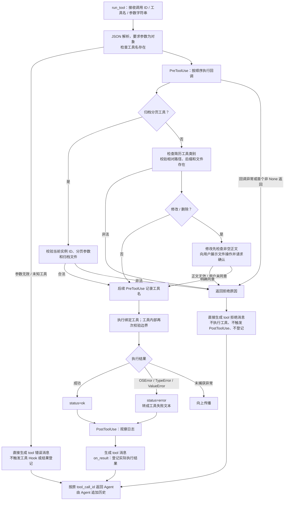
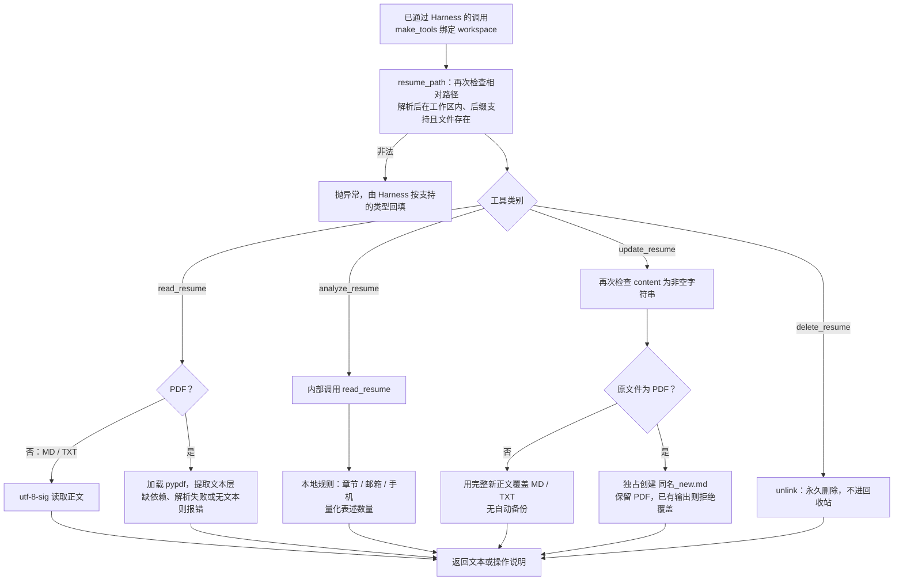
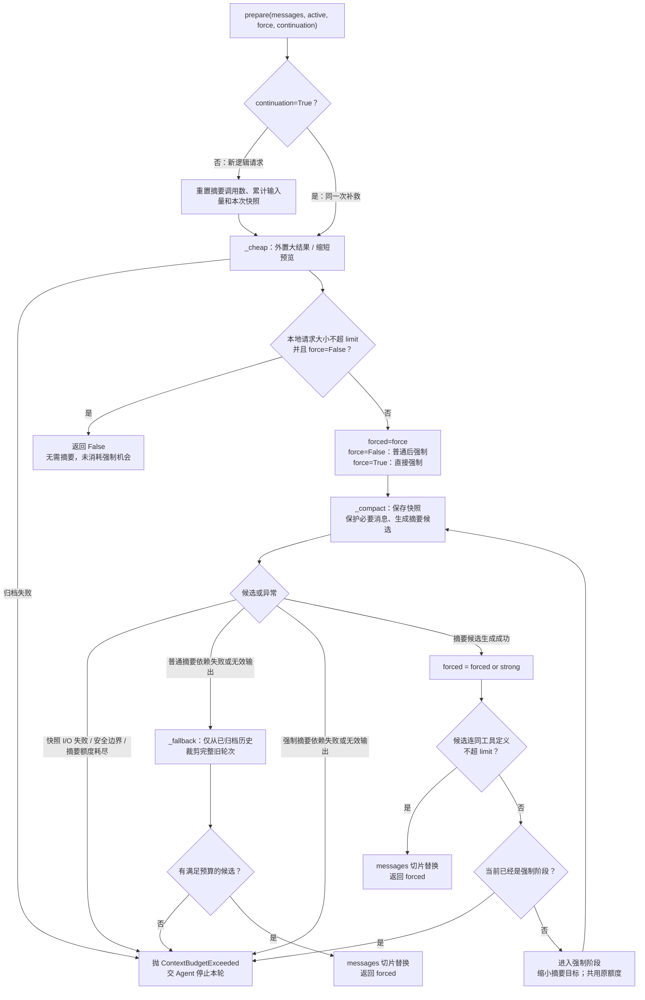
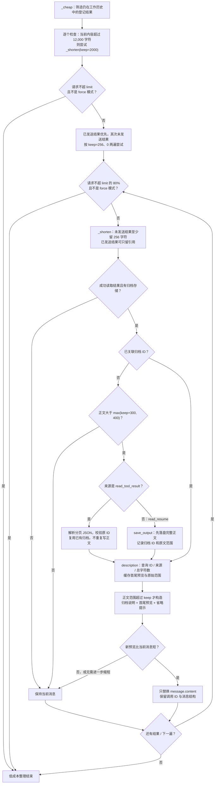
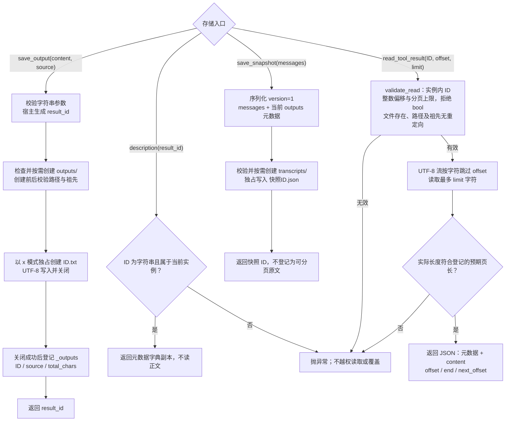

# MiniAgent 技术架构文档

> 版本：v1.3
>
> 日期：2026-11-28
>
> 阶段：Phase 1 · M5 已实现，验收见当前测试；M6–M10 为后续设计
>
> 关联文档：[PRD](PRD.md) · [Roadmap](ROADMAP.md) · [项目开发规则](../DEVELOPMENT_RULES.md)

## 阅读导航与图例

本文以当前工作区的 M1–M5 实现为准。建议先读整体架构与 Agent Loop，再按模块深入；M6–M10 仅是后续设计，不参与当前运行链路。

- [1. 当前架构与模块职责](#current-architecture)
  - 1.1 调用链与消息契约
  - 1.2 Hook 与文件边界
  - 1.3 预算、摘要与归档
  - 1.4 整体架构图
  - 1.5 CLI 与会话流程
  - 1.6 Agent Loop 与超限重试
  - 1.7 模型接入
  - 1.8 Harness、审批与结果回填
  - 1.9 简历工具
  - 1.10 上下文压缩决策
  - 1.11 大结果归档与预览
  - 1.12 ArtifactStore 存取
- [2. 后续扩展接缝](#future-extensions)
- [3. Goal Loop 取舍](#goal-loop)
- [4. 验证与 Phase 2 交接](#verification)

图中实线箭头表示调用、数据传递或控制流，菱形表示条件判断；架构图中的虚线标明依赖装配或独立摘要请求。判断分支均带文字，不依赖颜色区分。整体架构图不是严格执行时序；各模块流程图才描述执行顺序。

<a id="current-architecture"></a>

## 1. 当前架构（M1–M5）

MiniAgent 保持为同步、单会话的教学 CLI。模型接口是一项可替换的依赖，不需要为 demo 恢复旧版的 Provider 类层级、独立注册表或异步适配器。

| 位置 | 当前职责 |
|---|---|
| [`__main__.py`](../../mini_agent/mini_agent/__main__.py) | `run_session()` 创建并复用消息、工具、Hook、会话归档和上下文管理器。`--context-chars` 配置预算；离线固定指令无摘要器，`--live` 装配 OpenAI 兼容客户端（默认 DeepSeek）及独立同模型摘要函数。 |
| [`agent.py`](../../mini_agent/mini_agent/agent.py) | `run_turn(..., max_steps=8, context=None, context_chars=50000)` 每次执行模型请求前整理上下文，传入深拷贝；逐个回填工具结果；处理有界超限重试、完成与预算停止。 |
| [`harness.py`](../../mini_agent/mini_agent/harness.py) | `run_hooks()` 按注册顺序调度同步回调；`run_tool()` 解析参数、查找工具、执行前置检查并生成带调用 ID 的工具结果；`default_hooks()` 配置审批与观察日志。 |
| [`tools.py`](../../mini_agent/mini_agent/tools.py) | 四个简历工具及 `read_tool_result` schema；`make_tools(workspace, artifacts=...)` 装配会话归档只读工具。简历仍由 `workspace_path()` / `resume_path()` 校验，工具不依赖模型。 |
| [`context.py`](../../mini_agent/mini_agent/context.py) | `ContextManager` 计量含 schema 的 JSON 字符预算，登记成功读取、归档预览、有界摘要、保护必要批次并替换工作历史。 |
| [`artifacts.py`](../../mini_agent/mini_agent/artifacts.py) | `ArtifactStore` 独占保存 UTF-8 原文和版本化消息快照；当前实例登记 ID，分页读取前后校验文件边界。 |
| [`tests/`](../../mini_agent/tests/) | `test_demo.py` 验证原有循环/权限；`test_artifacts.py`、`test_context.py`、`test_compact_cli.py` 验证归档、摘要/错误替身、预算和 CLI；无需真实端点。 |

### 1.1 调用链与消息契约

```text
run_session → run_turn(prompt, messages, ...)
  → UserPromptSubmit → append user
  → context.prepare(messages, active) → model(deepcopy(messages))
      明确 ContextOverflow：若尚有机会则更强压缩 → 重试本次模型请求一次
      预算/必要内容无法安全容纳：Stop(上下文预算不足) → 返回提示
  → 标记成功请求中的读取结果已读 → append assistant
      有 tool_calls：逐个 run_tool(call) → 登记结果 → append tool → 继续
      无 tool_calls：Stop(完成) → 返回答复或空响应提示
  → 步数耗尽：Stop(达到步数上限) → 返回提示
```

- 工作历史是可原地追加、压缩后可替换的字典列表；模型函数接收深拷贝，不能通过修改入参污染会话。摘要验证并通过预算检查后才替换 `messages[:]`；原文已归档，不在内存无限保留原始历史。具体模型 SDK 留在 CLI 入口，循环使用 OpenAI 兼容的 `role`、`tool_calls`、`tool_call_id` 结构。
- 收到一批工具调用时，先记录包含 `tool_calls` 的 assistant 消息，再逐个追加配对的 `role=tool` 消息；允许、拒绝和可处理错误都保留原始调用 ID。达到步数上限时也不会丢弃该步已发出的工具回填。
- 格式正确但参数非法或工具未知，直接回填错误；路径不合法或审批拒绝时不调用工具。支持的文件与参数错误转成工具结果；模型请求异常并不走工具错误分支。

### 1.2 Hook 与文件边界

| 事件 | 触发位置 | 当前作用 |
|---|---|---|
| `UserPromptSubmit` | 追加用户输入之前 | 记录输入字符数。 |
| `PreToolUse` | 参数解析及工具检查之后、执行之前 | 先校验简历路径，修改/删除再确认；通过后记录工具名。首个非 `None` 结果阻断，回调异常按拒绝处理。 |
| `PostToolUse` | 实际执行工具后，包括已捕获的工具错误 | 记录名称、状态、结果长度；不会重写结果。未执行的调用没有此事件。 |
| `Stop` | 本轮正常返回、步数耗尽或上下文预算无法满足 | 记录结束原因，当前无权阻止返回，不代表会话退出或业务目标达成。 |

工具与审批共享路径校验：拒绝绝对路径、设备名及解析后越界的相对路径/链接；工具执行时再次校验。`workspace/` 固定在项目根，离线模式仅对 `demo_resume.md` 发出调用。文本简历直接覆盖、无备份；PDF 生成 `_new.md` 时独占创建，不覆盖已有输出。路径检查不是操作系统沙箱，也不假设 `cwd` 能隔离 shell。真实模式会传输消息和工具结果，日志默认只记录事件元数据，审批提示不包含简历内容。

### 1.3 M5：预算、摘要与归档（已实现，验收见当前测试）

1. **计量和低成本整理**：默认 50,000 JSON 字符，包含 messages、工具 schema、结构和转义，不是 token。成功的 `read_resume` / `read_tool_result` 正文才可缩短；超过 12,000 字符的读取先外置原文再给前后预览（默认正文合计 2000 字符）。预算紧张时优先缩短已读内容，可仅保留 ID 引用；不改工具参数、修改/删除结果、拒绝或错误。分页读取复用原 ID，不重复外置同一原文。
2. **先归档再摘要**：保存完整工作消息与当前输出元数据快照，然后通过独立同模型、无工具调用整理历史。每次摘要输入至多 40,000 JSON 字符，输出至多 6000 字符；同一逻辑执行请求最多 4 call、累计输入至多 160,000 字符，更强压缩和服务端重试继续共用预算。大历史分片并明确标记为片段，不声称完整证据；live 还校验摘要完整结束、无拒绝/工具调用，超时或无效输出视为失败。
3. **保护与提交**：候选历史为 system + assistant 历史参考摘要 + active 用户原文及保留消息，保留 latest 闭合工具批次及本轮非只读批次。当前实现对 `read_resume`、`read_tool_result`、本地 `analyze_resume` 视为安全工具，其余批次按潜在副作用保护。工具调用与全部回填必须闭合；摘要是有损参考，不是 system 指令、确认事实或操作成功证明。候选验证并满足预算才替换工作历史，释放被替换的原始历史引用。
4. **失败与一次强制机会**：普通摘要失败，仅可在快照成功后按完整旧轮次裁剪；必要输入仍超限则 `Stop`。普通摘要成功但候选仍超预算，可尝试一次更强压缩；与服务端超限触发的强制压缩共用一次机会。live 仅将 `BadRequestError` 结构化错误中精确 `code == "context_length_exceeded"` 转为 `ContextOverflow`，不识别宽泛错误文本。重试只重发本次执行模型请求，不重放 tools、不重复审批、不重置 steps；强制压缩/重试再失败就停止。离线没有摘要器，只能归档后裁剪或停止。

CLI 为每次 session 生成宿主 ID，归档根固定在项目 `.mini_agent/sessions/<hostid>/`；`outputs/<id>.txt` 原样 UTF-8 保存输出，`transcripts/<snapshotid>.json` 保存版本化消息与输出登记元数据。文件独占创建，不覆盖；仅保存成功并关闭后登记 ID。`read_tool_result(result_id, offset=0, limit=4000)` 只认当前实例登记，单页最大 8000 字符，按字符偏移返回来源、正文和 next_offset；不能传任意路径，不能跨 session，不能据磁盘文件重启恢复。

归档明文持久化、无自动清理，可能含完整简历和提示词；CLI 会显示位置，事件日志仅元数据。归档路径及祖先拒绝符号链接、Windows junction 和解析重定向，读取时重新校验；这是应用边界而非 OS 沙箱。归档失败不以“已省略”替代未保存原文；已执行的工具也不会因预算停止回滚。

### 1.4 整体架构图



- **装配层**：CLI 创建一套会话对象，多轮复用；模型、归档和确认函数都是可替换依赖，不需要独立框架层级。
- **控制层**：Agent 决定何时请求模型、执行下一批工具及返回；Harness 决定某次工具调用是否允许执行。
- **数据层**：`messages` 是有限工作历史；`workspace/` 存用户文件；归档目录存明文原文和快照。磁盘归档不构成可恢复会话。
- **外部边界**：只有真实模式请求外部端点，消息与工具结果可能外发；摘要也是独立的外部请求。路径限制属于应用校验，不是 OS 沙箱。

### 1.5 CLI 与会话流程（`__main__.py`）



`Stop` 只结束一轮，不等于退出 REPL。图中的本轮返回包含正常完成、步数上限和预算不足；未在循环内处理的一般异常仍向上传播，不承诺自动恢复。归档根在会话创建时确定，目录与文件按需创建。

### 1.6 Agent Loop 与服务端超限重试（`agent.py`）



- 服务端超限重试只包围模型请求，不包围工具执行；不重放工具、不重复审批、不重置外层步数。
- 初次 `prepare()` 自己也可能升级到强制压缩并返回 `True`；这时即使模型首次请求就超限，也不会再给额外强制机会。
- `max_steps` 限制外层成功执行模型响应的循环，不将摘要请求计为执行模型步数；最后一步有工具调用时仍先完整回填，再报告步数上限。
- `mark_seen()` 是“本次请求成功发送过”的宿主标记，不证明模型理解了内容；后续整理可更积极地缩短已发送的读取结果。

### 1.7 模型接入与摘要请求（`__main__.py`）



离线模式没有 `.summarize`，会话因此装配 `summarize=None`。真实模式的 `ask.summarize` 是同一模型的独立无工具入口，不是让执行模型通过工具调用自行压缩历史。模型配置默认值见模块 README，不在图中复制密钥。

### 1.8 Harness、审批与结果回填（`harness.py`）



- `PreToolUse` 的拒绝、参数错误和工具执行错误都会回填，但只有实际执行后的 `ok/error` 走当前 `on_result` 登记路径，不能把所有回填都画成已登记。
- `run_hooks()` 对 `PreToolUse` 回调异常采取阻断；其他事件回调异常只记录并继续。默认日志不包含简历正文。
- `UserPromptSubmit` 在 Agent 追加用户消息之前触发，`Stop` 在本轮返回前触发；两者不属于 `run_tool()` 内部执行流程。

### 1.9 简历工具流程（`tools.py`）



权限审批在 Harness，不在工具内部。工具再次验证文件与参数，但不会自行向用户询问。PDF 分支只提取文本，不执行 OCR；规则分析不是模型评分；`read_tool_result` 实际绑定归档对象，不走简历文件分支。

### 1.10 上下文压缩总决策（`context.py`）



**三个容易混淆的变量：**

| 名称 | 表示什么 | 不表示什么 |
|---|---|---|
| `force` | 调用方要求本次直接强制收缩，通常由服务端明确超限触发 | 不是“当前一定超过本地字符预算” |
| `strong` | 循环当前正在做普通还是强制摘要 | 不是服务端重试次数 |
| `forced` | 本次准备流程是否已经使用强制阶段，返回给 Agent 限制后续补救 | 普通摘要成功不意味着它为 True |
| `continuation` | 是否延续同一次逻辑请求的摘要额度 | 不负责保留 Agent 的强制机会状态；后者由 `forced` 传递 |

`force=True` 时，即使 `_cheap()` 后已满足本地字符预算，也继续进入强制摘要，因为服务端预算与本地计量不同。普通摘要失败会先尝试归档后的旧轮次裁剪；并非所有失败都会升级强制摘要。强制失败、安全边界异常和额度耗尽均直接停止。

#### 摘要候选如何构造与保护

1. `_compact()` 先保存当前历史快照，再由 `_protected()` 确定 system、本轮用户原文、最新闭合工具批次及本轮潜在副作用批次。当前轮工具调用 ID 必须唯一，后续工具结果必须数量、角色和 ID 完整配对。
2. 非保护内容作为明确标记的历史数据交给 `_summarize()`；没有非保护内容时也可整理保护内容，但保护原文仍保留，不会被摘要替代。
3. `_summarize()` 把 JSON 历史分片，上一片摘要与下一片一起输入；单次完整请求不超 40,000 JSON 字符、最多四次、累计不超 160,000 字符。预算在请求前扣除，失败调用也计数。返回值必须是非空字符串且不超本次目标。
4. 普通摘要目标为 `min(6000, max(128, limit // 4))`；强制目标为 `min(3000, max(128, limit // 8))`。字符目标不等于服务端 `max_tokens`，两个限制分别校验。
5. 候选为 system + assistant 历史参考摘要 + 保护的非 system 消息；摘要明确标记为有损参考而非确认事实。完整候选符合本地预算才 `messages[:] = candidate`，保持列表身份。
6. `_fallback()` 只有成功保存过本次快照才裁剪；按下一条用户消息确定完整旧轮次，保留 system，不删除当前轮来强行凑预算。裁剪不够就返回失败。

### 1.11 大结果归档与预览（`context.py`）



首轮大结果处理同样调用图中 `_shorten()` 的资格、归档和收益检查；图中在后续预算收缩阶段展开这条子流程，避免重复绘制。强制模式不以 80% 条件提前退出，而是尝试全部候选结果；80% 是普通模式尝试留余量的目标，不是最终接收门槛，最终仍由 `prepare()` 检查 `limit`。

归档与预览的数据关系如下，示例 ID 均为说明用途：

```text
result["artifact"] = "abc123"                    # 宿主内存中的归档 ID
        │
        ├─ ArtifactStore._outputs["abc123"]       # 内存元数据登记，不含正文
        │    {"result_id": "abc123",
        │     "source": "read_resume:resume.md",
        │     "total_chars": 20000}
        │
        ├─ outputs/abc123.txt                     # 磁盘完整原文
        │
        └─ result["page"]                         # 该结果对应的原文范围及预览缓存
             offset / end / length / head / tail
```

`description(result["artifact"])` 只返回元数据副本；`json.dumps({**metadata, ...})` 只生成预览头部字符串，不执行写入。`offset/end` 表示原文范围，结束位置不包含在内，不代表拼接后的预览字符串下标。缓存完整正文会被移除，仅保留有界首尾内容；正文需要时通过分页工具读取。

### 1.12 ArtifactStore 存取流程（`artifacts.py`）



- `_check_path()` 拒绝路径与祖先的符号链接、Windows junction 和解析重定向；`_directory()` 创建前后均检查。I/O 或校验失败抛给调用方，不自动删除失败文件，也不覆盖已有文件。
- 分页默认 `offset=0, limit=4000`，上限 8000；偏移按字符，不按 UTF-8 字节。读到登记末尾时 `next_offset=null`。页长校验能发现部分长度变化，但不是内容哈希校验，不承诺检测所有篡改。
- `description()` 查的是当前实例内存登记，磁盘文件存在不等于可读取；快照 ID 也不等于 `result_id`。目前没有加载快照、恢复 `_outputs` 或恢复会话的入口。

<a id="future-extensions"></a>

## 2. 后续扩展接缝（M6–M9，未实现）

按验收需要拆分，不预先承诺模块文件或重建框架。优先围绕当前的 `model(messages)`、会话装配和工具分发扩展。

| 模块 | 接入位置 | 关键约束 |
|---|---|---|
| M6 Memory | 会话/任务装配时检索，交给请求视图 | 本地 JSON 起步；用户确认事实、摘要和缺口分开，保留来源与确认状态。不要把模型生成的内容、JD 要求或压缩摘要当成候选人的事实。 |
| M7 Task & State | 在工具循环外管理任务状态与检查点 | 用任务/步骤 ID 及输入标识确认哪些步骤已完成；未完成、失败和副作用不确定要可区分。文件已写但检查点未写时，不以「没有检查点」推定可以重做。 |
| M8 Integrated Harness | 会话/任务入口组合前述能力 | 先接专用 JD 输入和面试题报告输出；每一步复用原有权限路径，新增报告写入须审批。任务 ID 串联运行元数据，避免在日志、检查点整份保存简历正文。 |
| M9 Workflow Runtime（可选） | 任务层 | 只有 M8 出现真实的顺序/并行编排需求才引入；重试不能绕过审批或重放未知副作用；不替代 Phase 2 的面试状态机。 |

### 2.1 独立知识库接缝（M6K，未实现）

后续只读 `knowledge/` 中的 MD/TXT/有文本层 PDF，按标题和段落生成 chunks，记录 source/version，先做本地关键词或 BM25，再通过 `search_knowledge` / `read_knowledge_chunk` 返回有界结果及可核对来源。中文分词/召回须评测，必要时再考虑 hybrid；未经确认不使用云端 embedding。知识库是外部参考，不是候选人事实或 M6 Memory，检索结果同样是不可信数据，不扩大工具权限。此处只预留计划，不实现文件读取器、索引或工具。

<a id="goal-loop"></a>

## 3. s17 Goal Loop：借鉴与取舍（M10，可选，未实现）

参考源为 [code copy.py](<../../参考文档/code copy.py>)（s17）。`AgentSession._run_query()` 先处理并回填工具结果；无工具调用时才问 `GoalController.evaluate_after_turn()`。`block` 把缺证据原因写回同一循环；真正返回前才触发现有的观察型 `Stop`。这条边界比借用参考示例的工具、SDK 或类结构更重要。

| s17 设计点 | MiniAgent 取舍 |
|---|---|
| `/goal` 命令和会话级控制器 | 在会话入口识别设置、替换、查询与清除；查询/清除不调用模型。目标默认只在当前会话内有效。 |
| `PromptGoalEvaluator` 独立请求，无工具 | 注入独立调用函数，可与执行端用同一兼容端点/模型，但必须是单独请求，不传工具 schema 或工具调度器。当前 `live_model()` 返回的执行函数会发送工具 schema；它附带的摘要函数虽无工具，但不是目标判断契约，均不能直接当作判断器。 |
| `transcript_text()` 优先保留最近完整消息；最新一条过长时保留头尾 | 借鉴有界证据视图，限定本目标及明确关联的证据；保留来源、工具结果状态和必要的上下文。超长内容标注省略，截断后无法核对就视为证据不足。它不是 M5 传给执行模型的上下文视图。 |
| `max_turns` 和 Stop 阻断次数 | 复用单次提交已有的 `max_steps`；另设 `block_cap`，限制本次提交因判断结果实际续跑的次数。沿用同一循环，不递归调用 `run_turn()`、不重置步数、不伪造新的人类输入。 |
| `goal_status` 事件/`restore()` | 基础版只保存会话状态。若有重启恢复需求，再复用 M7 存储目标事件，显式恢复最后仍活跃的目标；参考 CLI 本身没有提供完整会话落盘恢复。恢复元数据不代表旧证据仍在，也不自动执行。 |
| `defer`、后台结果回接、通用工具 | 当前没有后台任务，不实现 `defer` 或自动恢复；不移植 `bash`、`glob`、任意读写/编辑工具，也不新增 SDK。 |

### 3.1 返回边界与状态

```text
执行模型响应 → 记录 assistant
  有工具调用 → 按现有规则执行/拒绝并全部回填 → 继续（同一 max_steps）
  无工具调用 → 无活跃目标：按原行为触发 Stop 并返回
             → 有活跃目标：独立判断有限证据
                 缺证据且预算允许 → 追加标明来自 Harness 的反馈 → 继续
                 达成 / 不可完成 / 判断失败 / 达到上限 → Stop 观察 → 交还控制权
```

- `GoalState` 只需保存完成条件、目标对应的证据范围、最近状态与理由。单次提交的执行模型步数和续跑计数独立管理；不把判断器请求混计为执行模型步数。设置新目标时重建证据范围，新提交可以重置单次计数但不能把无关会话历史计为目标证据。
- 判断契约为 JSON 对象：布尔 `ok`、非空 `reason`、布尔 `impossible`（可缺省为 `false`）；不允许 `ok` 与 `impossible` 同真。输出先校验，再驱动状态。`ok` 且证据满足才达成；`impossible` 为不可完成；其余有效负面结果才可能续跑。达成或不可完成后关闭活跃目标，但保留终态供查询。
- `block_cap=N` 最多允许 N 次实际续跑；收到下一次缺证据判定时交还控制权。最后一次执行模型响应已经用完 `max_steps` 时不得续跑；若最后一次仍有工具调用，先完整配平再返回步数上限，不将耗尽预算当作目标达成。判断超时、异常、非法响应或到达上限都不算成功，保留活跃目标供用户处理。
- 沿用 `Stop` 作为确定返回后、实际返回前的观察事件；新控制点在它之前。自动续跑不重新触发 `UserPromptSubmit`。外层用可观察的目标状态区分普通答复、达成、失败、判断错误和预算退出，不能只打印执行模型的最后一句话。

### 3.2 证据与权限

判断器只检查提供的数据，不访问文件、调用工具或给出授权；完成条件、简历正文和工具输出均是待分析的数据。执行模型的口头陈述、拒绝/错误消息、缺失或被省略的正文均不能当成成功的工具证据。对 PRD 的只读演示，优先由宿主对照已成功的读取结果核对引文，再让判断器检查引文与追问是否相关。判断器反馈只说明缺了什么，不替代用户审批，也不能扩大工具集合。发送给真实判断端点的材料遵循执行端的隐私规则，人工验收使用合成或脱敏内容。

<a id="verification"></a>

## 4. 验证与 Phase 2 交接

- 在 `mini_agent/` 运行 `python -m pytest`；M5 专项为 `python -m pytest tests/test_artifacts.py tests/test_context.py tests/test_compact_cli.py`，以实际输出为验收，不预报数量或通过结果。CLI 用合成超长正文验证 `python -m mini_agent --context-chars 10000 "读简历"` 的归档与预览；真实摘要用合成多轮材料在 `--live` 模式验收。
- 当前离线和真实模型通过同一个消息契约进入工具循环；离线测试注入可调用的模型函数和确认函数，把文件放在 `tmp_path`。未来判断器也用独立替身，断言无目标无调用、判断器无工具、证据范围、坏输出、权限拒绝与两个预算边界。CLI 验收断言可见状态和文件副作用，不依赖真实模型文本固定。
- Phase 2 借鉴调用边界、证据分层、权限策略、检查点与离线测试；用 HTTP、用户级鉴权、业务状态机和持久化替代教学 CLI，不直接复用本地工作区限制作为用户隔离。
- [OfferLoop 架构](../offerloop/ARCHITECTURE.md) 已区分 Interviewer 和 Evaluator：前者提问，后者无工具、按单题证据评分，故障时不伪造分数。复用的是「执行与判断分离、结果必须有证据」，不是 Goal Loop 的自动续跑或完成/未完成二元判断。
