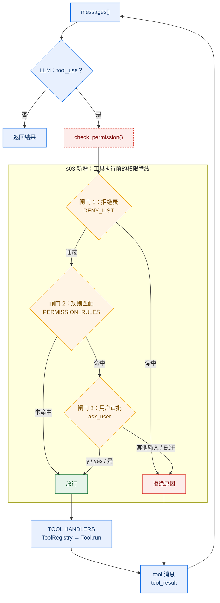

# MiniAgent s03：Agent Loop + Tool Use + Permission

这是 OfferLoop 的第三个学习模块：在 s02 工具调用的基础上加入简历修改、删除和危险操作授权，理解「模型想改文件 → Harness 拦截 → 用户确认 → 执行并回填结果」的完整闭环。

## 这一模块解决什么问题

- 工具如何以 JSON Schema 声明给模型；
- 工具选择为什么由各工具 description 决定，而不是写进系统提示词；
- 模型返回 `tool_calls` 后，如何解析参数、执行并回填 tool 消息；
- 工具失败（文件不存在、格式不支持、参数错误）如何不打断 Agent 循环；
- 一轮多个工具调用如何逐个配平；
- 文档读取（PDF / DOCX / Markdown / TXT）如何统一成纯文本；
- 修改 / 删除文件前如何强制用户确认，以及拒绝后如何继续对话。

## 工具

| 工具 | 作用 | 需要确认 |
|---|---|---|
| `read_resume` | 读取简历文件，返回纯文本 | 否 |
| `read_jd` | 读取岗位 JD 文件，返回纯文本 | 否 |
| `analyze_resume` | 规则版简历结构分析：联系方式、章节、量化指标、日期区间、字数 | 否 |
| `update_resume` | 把模型改写后的完整简历写入文件 | 是 |
| `delete_resume` | 永久删除简历文件 | 是 |

`analyze_resume` 只陈述规则可检测的事实，不做主观评价；「是否匹配 JD」由模型结合原文判断。工具内不调用模型，后续 s10 再引入子 Agent。

### 修改与删除规则

`update_resume(path, content)` 要求 `content` 是**完整新正文**，不是 diff：

| 源格式 | 行为 |
|---|---|
| `.md` / `.markdown` / `.txt` | 原地替换；写入前生成 `*.bak-YYYYmmdd-HHMMSS` 备份 |
| `.docx` | 生成 `<stem>_new.docx`（纯文本段落，不保留原格式），原文件不动 |
| `.pdf` | 生成 `<stem>_new.md`，原文件不动；PDF 无法直接重写 |

- 目标 `_new` 文件已存在时拒绝写入，避免覆盖上一次结果；
- 文本写入使用同目录临时文件 + `os.replace` 原子替换，UTF-8 无 BOM；
- `delete_resume` 只允许删除受支持后缀的文档，且是**永久删除**。

### Permission System

执行任何工具前依次通过三道门：



蓝框是 s02 保留的循环与工具分发；红框是 s03 新增的权限入口，三道门内部按顺序执行。规则未命中直接放行，命中只触发用户审批；只有闸门 1 是硬拒绝。拒绝和放行都会变成 `tool_result` 回到 `messages[]`，循环不变。

| 门 | 实现 | 行为 |
|---|---|---|
| 1. 拒绝表 | `DENY_LIST` / `check_deny_list` | 危险命令直接拒绝，不询问 |
| 2. 确认规则表 | `PERMISSION_RULES` / `check_rules` | 命中后进入用户确认 |
| 3. 用户确认 | `ask_user` | 终端询问，`y / yes / 是` 才放行 |

- `update_resume` / `delete_resume` 由规则表兜底，每次都会询问；目标越过工作目录（默认进程启动目录）时，原因变为「路径不在工作区内」；
- 规则命中表示「需要确认」，不是自动拒绝；只有拒绝表是硬阻断；
- 工具通过 `permission_request()` 提供安全摘要（路径、模式、大小、预览），提示不打印原始参数，避免泄露简历正文；
- 用户拒绝或 EOF 不会抛异常，而是回填一条 tool 消息，模型可以解释或换方案；
- 拒绝表目前覆盖命令型工具；接入 bash（s04）后 Gate 1 直接生效。

支持的文档格式：

| 格式 | 解析方式 | 说明 |
|---|---|---|
| `.pdf` | pypdf | 扫描件（无文本层）会明确报错，暂不支持 OCR |
| `.docx` | python-docx | 读取段落、表格、页眉页脚；不支持旧版 `.doc` |
| `.md` / `.markdown` | 编码回退读取 | — |
| `.txt` | 编码回退读取 | `utf-8-sig` → `utf-8` → `gb18030` |

限制：单文件 ≤ 10 MB，正文 ≤ 50,000 字符（超出截断并标注）。日志只记录工具名和结果长度，不记录正文。

## 明确不做（留给后续模块）

- **s04**：沙箱、Hook、工作区目录白名单；
- **s08 / s09**：上下文压缩、记忆；
- **s10**：工具内调用 LLM 的子 Agent；
- OCR / 扫描件识别、旧版 `.doc`；
- 流式输出、重试/退避、预算控制、持久化、RAG、FastAPI / 数据库 / 前端。

## 架构

```text
CLI / config
    ↓
MiniAgent（循环 + 历史 + 停止条件）
    ├── _on_assistant_turn   工具分发入口
    │       └── ToolDispatcher → check_permission → ToolRegistry → Tool
    ├── tools.py             五个业务工具 + 注册表 + 分发器
    ├── permissions.py       危险操作请求与授权策略
    ├── documents.py         PDF / DOCX / MD / TXT → 纯文本
    └── LLMProvider          模型边界：上层只认 AssistantTurn
            ├── OpenAICompatible（DeepSeek 等兼容端点）
            └── Fake（离线脚本）
    ↓
models / errors（不可变数据 + 异常层级）
```

五条原则：

1. **一个控制缝**：`_on_assistant_turn` 决定这一步之后是否继续，主循环不感知具体工具。
2. **一个模型边界**：业务代码不接触 SDK 对象。
3. **历史只增不改**：消息 `frozen`，Provider 只拿到 tuple 快照。
4. **工具失败不打断循环**：Dispatcher 把异常转成 tool 消息，让模型自我纠正。
5. **危险操作先问再做**：修改 / 删除每次都要用户确认；拒绝表命中则直接阻断。

## 目录

```text
mini_agent/
├── mini_agent/
│   ├── models.py            # Message / AssistantTurn / ToolCall / ToolSpec ...
│   ├── errors.py            # 异常层级（ToolError / DocumentError）
│   ├── config.py            # Settings 与 .env 加载
│   ├── documents.py         # 文档加载与文本规范化
│   ├── permissions.py       # PermissionRequest / Gate / 交互式询问
│   ├── tools.py             # 工具、注册表、分发器、规则分析
│   ├── agent.py             # Agent Loop + 工具分发
│   ├── cli.py               # 单次模式与 REPL
│   └── providers/
│       ├── base.py          # LLMProvider Protocol
│       ├── openai_compat.py # 唯一接触 openai SDK 的文件
│       └── fake.py          # 离线脚本 Provider
└── tests/                   # 125 个离线测试
```

## 快速开始

```bash
cd mini_agent

python -m venv .venv
source .venv/Scripts/activate        # Git Bash
# PowerShell: .venv\Scripts\Activate.ps1

python -m pip install -U pip
python -m pip install -e ".[dev]"
```

### 离线模式（不需要 API key）

```bash
python -m mini_agent --provider fake "你好"
```

REPL：

```bash
python -m mini_agent --provider fake -v
```

可用命令：`/history`、`/reset`、`/help`、`/exit`。`/history` 对 tool 消息只显示字符数，不打印简历 / JD 正文。

### 真实模型

复制 `.env.example` 为 `.env`，填写 `MINI_AGENT_API_KEY`：

```dotenv
MINI_AGENT_PROVIDER=deepseek
MINI_AGENT_API_KEY=sk-你的key
MINI_AGENT_BASE_URL=https://api.deepseek.com
MINI_AGENT_MODEL=deepseek-chat
```

读取并对比简历 / JD：

```bash
python -m mini_agent "帮我看看 resume.pdf 和 jd.txt 的匹配度"
```

模型会自动调用 `read_resume`、`read_jd`，需要结构事实时调用 `analyze_resume`。

修改简历：

```bash
python -m mini_agent "读一下 resume.md，按分析结果优化后再写回"
```

模型会依次调用 `read_resume` → `analyze_resume` → `update_resume`；写入前终端会打印目标路径、模式和正文预览，输入 `y` 才会执行。PDF / DOCX 会生成 `_new` 文件，原文件不动。

> `.env` 已被 `.gitignore` 忽略。程序不会打印 key，也不提供 `--api-key` 参数。

### 环境变量

| 变量 | 默认值 | 说明 |
|---|---|---|
| `MINI_AGENT_PROVIDER` | `deepseek` | `deepseek` 或 `fake` |
| `MINI_AGENT_API_KEY` | 无 | 真实模式下必填 |
| `MINI_AGENT_BASE_URL` | `https://api.deepseek.com` | OpenAI 兼容端点 |
| `MINI_AGENT_MODEL` | `deepseek-chat` | 模型名 |
| `MINI_AGENT_MAX_STEPS` | `8` | 单次 `run()` 的最大模型调用次数 |
| `MINI_AGENT_TEMPERATURE` | `0.3` | 采样温度，范围 0–2 |

优先级：进程环境变量 > `.env` > 代码默认值。

## 测试

```bash
python -m pytest -q
```

全部离线，不读取真实 key。覆盖：

- 单轮 / 多轮历史累积、system 不重复；
- `max_steps` 保护、空响应停止、`finish_reason=length`；
- 工具调用闭环：参数解析、执行、tool 消息回填、多调用配平；
- 未知工具、非法 JSON、工具异常、未注册工具时的错误回填；
- TXT / Markdown / DOCX / PDF 读取、编码回退、扫描件拦截、大小与截断；
- 规则版简历分析；
- 文本原地修改与备份、PDF / DOCX 生成 `_new` 文件、目标冲突与长度校验；
- 永久删除、后缀限制；
- Permission System：拒绝表、越界规则、每次确认、y/n/EOF、读取工具不触发询问、拒绝不落盘；
- OpenAI 适配器的请求 payload（含 tools schema）、响应映射、错误翻译；
- 配置优先级、BOM `.env`、缺 key 快速失败、CLI 冒烟。

## 退出码

| 退出码 | 含义 |
|---|---|
| 0 | 正常结束 |
| 1 | 配置/用法错误 |
| 2 | 单次模式下的模型调用故障 |
| 130 | Ctrl+C |

## 验收状态

| # | 标准 | 状态 |
|---|---|---|
| S1 | `--provider fake "你好"` 正常输出，退出 0 | ✅ |
| S2 | `pytest` 全绿，离线 | ✅ 125 passed |
| S3 | fake 脚本驱动 `tool_call → tool 消息 → 最终回答` | ✅ |
| S4 | TXT / MD / DOCX / PDF 四类文档读取 | ✅ |
| S5 | 扫描件 PDF、文件不存在、扩展名不支持均回填错误 | ✅ |
| S6 | 未知工具 / 非法 JSON 不打断循环 | ✅ |
| S7 | 一轮多个 `tool_calls` 全部配平 | ✅ |
| S8 | 工具反复调用时 `max_steps` 生效 | ✅ |
| S9 | 日志与 `/history` 不泄露简历 / JD 正文 | ✅ |
| S10 | `compileall` 通过、中文无乱码 | ✅ |
| S11 | 真实 API 完成「读简历 + 读 JD + 对比」 | ✅ |
| S12 | 文本简历原地修改并生成 `.bak` 备份 | ✅ |
| S13 | PDF / DOCX 生成 `_new` 文件，原文件不变 | ✅ |
| S14 | 删除为永久删除，且只允许受支持后缀 | ✅ |
| S15 | 未配置授权时修改 / 删除一律拒绝 | ✅ |
| S16 | 用户拒绝后文件不变，tool 消息配平，循环继续 | ✅ |

## s04 接入点

| s03 位置 | s04 变化 |
|---|---|
| `documents.py::load_document` | 增加允许目录（工作区根）限制 |
| `tools.py::ToolDispatcher` | 增加执行前 / 后的 Hook |
| `permissions.py` | 增加 bash 工具规则与“本次会话放行”等更细粒度策略 |

## 已知边界

- 同一个 `MiniAgent` 不支持并发 `run()`；s11 再引入任务管理。
- 本地文件读取在 `asyncio.to_thread` 中执行，但没有工具级超时。
- DOCX 文本框里的文字无法提取（python-docx 限制）；扫描件 PDF 需要 OCR。
- PDF 多栏排版的阅读顺序可能不理想。
- 工具结果直接进入上下文；单份文档已截断到 50k 字符，长文档压缩留给 s08。
- 写回文本时统一转成 UTF-8；原编码（如 GB18030）只保留在备份文件里。
- 重写 DOCX 只保留纯文本段落，原样式、图片、表格会丢失；PDF 只能生成 `.md` 副本。
- 备份和 `_new` 文件不会自动清理。
